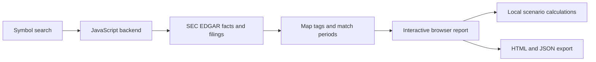

# Fundamental Research Desk

An interactive company-research tool built around reported financial facts and transparent calculations. Enter a US stock symbol to explore financial history, business segments, cash flows, and editable valuation scenarios.

**[Open the app](https://fundamental-research-desk.comfydance.chatgpt.site/)** · [Contributing](CONTRIBUTING.md) · [Detailed methodology](docs/METHODOLOGY.md)

This is an early-stage research tool, not an investment recommendation or a verified fair-value estimate. Coverage varies by company. A blank field means extraction has not established the figure; it does not mean the company did not disclose it.

## What it does

- Search-first homepage with bookmarkable reports, such as `/?ticker=AAPL`.
- Up to five annual periods, supported standalone quarters, and trailing twelve-month totals.
- Filing links and accounting-tag provenance for reported figures.
- Revenue breakdowns and reviewed segment profits where supported.
- Cash, selected debt, cash-use and maturity disclosures, with explicit coverage gaps.
- A five-year cash-flow model, sensitivity analysis and partial enterprise-to-equity bridge.
- Optional category growth and segment-margin assumptions when reported bases reconcile.
- Comparison with up to two user-selected companies.
- Interactive HTML export and normalized JSON downloads.

Valuation requires explicit reinvestment, discount-rate and terminal-growth inputs. Historical facts, calculated metrics and future assumptions are kept distinct.

## Run locally

Requirements: Node.js 20 or newer, npm, and Bash for the build script. There are no third-party runtime dependencies and no Python requirement.

```bash
git clone https://github.com/atelier-ritz/fundamental-research-desk.git
cd fundamental-research-desk
npm run build
npm test
npm run validate
npm run dev
```

Open **http://127.0.0.1:4173**. The homepage starts with search; no company is selected by default. Stop the server with Ctrl+C.

The dev server imports the generated Worker once at startup. After changing source, rebuild and restart the server. Run the build before tests: one regression suite exercises the assembled Worker itself.

SEC data access requires a network connection and may be restricted or rate limited. The test suite uses saved public SEC fixtures; it does not require live SEC calls or an API key. Original SEC company-facts JSON can also be imported from the report's Sources section.

## Architecture

The application uses vanilla JavaScript, HTML and CSS. **No LLM or OpenAI API is called when a symbol is submitted.** Research summaries are deterministic rules over the displayed data.



The backend identifies issuers through the SEC ticker directory, fetches company facts and filing metadata, normalizes eligible periods, and enriches supported business breakdowns. The browser calculates ratios and scenarios. Reviewed company profiles and selected custom-tag supplements are versioned source data, not a universal automated filing parser.

The hosted app currently runs through ChatGPT Sites as a Cloudflare Worker. There is no application database, object storage or scheduled data pipeline configured. In-memory caches are temporary. Analyze bypasses the normalized-company cache and browser response cache; metadata caching remains separate. Earnings-announcement freshness is not automatically verified.

## Source map

| Path | Responsibility |
| --- | --- |
| `src/page.html`, `src/style.css`, `src/app.js` | Homepage, report layout and interactions |
| `src/worker.mjs` | HTTP routes and SEC retrieval |
| `src/finance.mjs`, `src/quarters.mjs` | Field mappings, period normalization and valuation calculations |
| `src/forecast.mjs`, `src/category-ui.js` | Scenario inputs and category forecasts |
| `src/business.mjs`, `src/business-profiles.json` | Supported filing extraction and reviewed segment profiles |
| `src/coverage.mjs`, `src/strength.mjs`, `src/research-summary.mjs` | Coverage, financial strength and rule-based observations |
| `src/market*.mjs`, `src/market-ui.js` | Optional price provider and manually sourced prices |
| `src/snapshot.json` | Dated Microsoft dataset used by fixtures and standalone report generation |
| `test/` | Formula, normalization and assembled-backend regression tests |
| `scripts/` | Build, artifact validation and local server |
| `worker/index.js`, `report.html` | Generated files; rebuild instead of editing directly |
| `.openai/hosting.json` | Existing Sites deployment identity; contains no API secret |

### HTTP endpoints

- `/` — homepage, or a report when a `ticker` query parameter is supplied.
- `/api/company?ticker=AAPL` — normalized company data; `refresh=1` bypasses the temporary normalized-company cache.
- `/api/market/status` — whether the optional price connection is configured.
- `/api/market/quote?ticker=AAPL` — optional provider quote, subject to key availability and quota.

## Optional price data

Core financial research needs no paid API key. Automatic end-of-day prices use an optional server-side `ALPHA_VANTAGE_API_KEY`. Manual dated prices work separately.

Set the key as a secret in your deployment environment. Never commit it or put it in HTML, browser storage, fixtures, or the hosting manifest. The local dev server currently supplies no provider environment to the Worker, so automatic quotes are disabled locally by default. Provider limits apply; no real-time price or analyst-consensus feed is implied.

## Financial coverage and limitations

The supported path is US GAAP filers with USD facts and compatible annual and quarterly periods. Different companies use different accounting tags and definitions. Adding a synonym without verifying its scope can produce incorrect totals.

Examples covered by regression tests:

- Apple current marketable securities, commercial paper and dividends use alternative standard tags.
- Amazon cash purchases use an issuer-specific productive-assets mapping. Its company-defined free cash flow nets property-sale proceeds and incentives; the report separately reconciles that definition to CFO minus gross purchases.
- Reviewed Microsoft and Amazon segment operating income reconciles to company profit before separate segment margins can be modeled.

Custom-tag supplements have explicit dates and sources and are not automatically refreshed for later revisions. Other limitations include incomplete equity claims and dilution, no systematic corporate-action or acquisition review, and incomplete segment coverage. General industrial-company DCF is withheld for screened financial businesses. Historical growth and margins do not establish future performance.

See [methodology](docs/METHODOLOGY.md) and the app's coverage panel before interpreting results.

## Contribute

Data extraction and reconciliation are the highest priorities. Useful contributions include sourced mapping fixes, issuer regression fixtures, safer quarter derivation, reconciled segment disclosures, accessibility improvements and clearer missing-data explanations.

Read **[CONTRIBUTING.md](CONTRIBUTING.md)** for the development workflow and evidence expected in a pull request. Open an issue with a ticker, fiscal period, source filing and reproducible example. Do not include API keys or private account information.

## Deployment and licensing

Local development does not require Sites access. The tracked hosting manifest identifies the existing live app; fork contributors should use their own hosting configuration and should not change that identity in ordinary pull requests. AWS or another JavaScript runtime would require a request-handler adapter and deployment setup.

No open-source license has been selected yet. Public visibility allows inspection; it does not by itself grant general redistribution or commercial-use rights.
